<p align="center">
  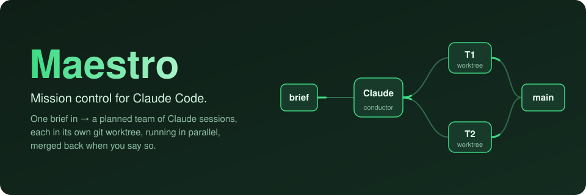
</p>

<p align="center">
  
  
  
  
</p>

**Maestro turns one written brief into a team of Claude Code sessions.**
A *conductor* session plans the work, Maestro runs every task in its own git worktree — independent tasks in
parallel — routes every question to one inbox, and merges the results back into your branch when you approve.

Maestro does no AI work itself. It is an orchestrator and a window onto the `claude` CLI you already use.

---

## ▶ See it run

A real mission, recorded from Maestro's terminal (condensed). The brief: *"add `capitalize`, `clamp`, an index
file and a README"*. Two tasks run in parallel, get reviewed, then the third task builds on both.

<p align="center">
  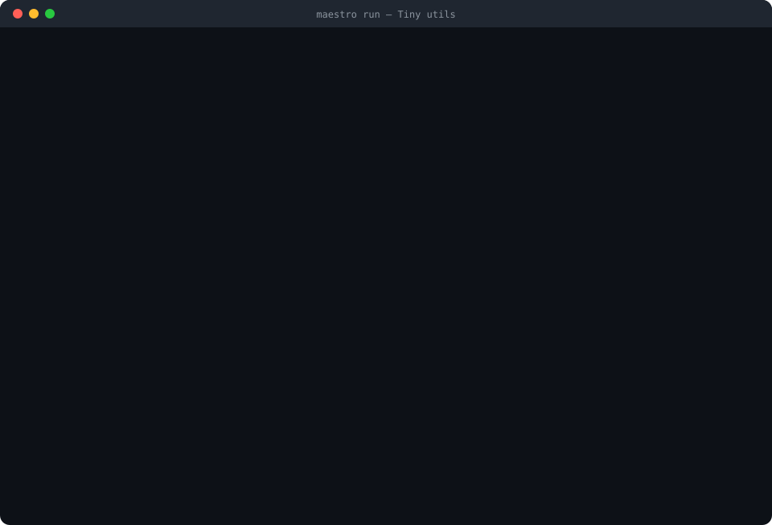
</p>

What the user did during that whole mission: **typed `y` a handful of times, and `m` once to merge.**

| Result of the run | |
|---|---|
| Tasks run | 5 (3 implementer + 2 spec-reviewer) |
| Tests on `main` after merge | **7 / 7 passing** |
| Prompts to the user | 10 (plan approval, permissions, merge) |
| Conductor used Claude's built-in subagents | **0** — every subagent became a visible Maestro task |

Full log: [`docs/superpowers/runs/2026-10-29-e2e.md`](docs/superpowers/runs/2026-10-29-e2e.md)

---

## 🧭 How it works

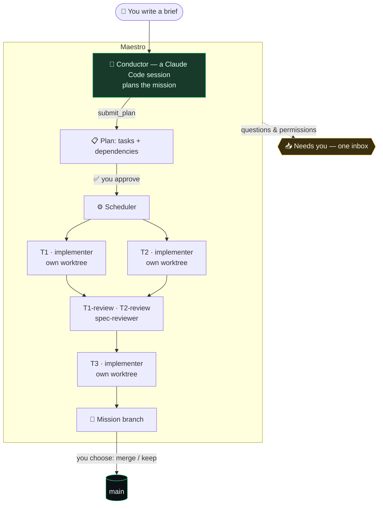

1. **You write a brief** — plain Markdown, a few lines is enough.
2. **The conductor plans it.** A long-lived Claude Code session runs the *superpowers* workflow
   (understand → plan → build → finish) and submits a plan through Maestro's bridge tools.
3. **You approve the plan** — or type a note and it re-plans.
4. **Maestro runs the tasks.** Each task is its own `claude` process, with its own role, in its own git worktree.
   Tasks with no unmet dependencies run at the same time (`--parallel N`).
5. **Every task's work is merged** into a mission branch as it finishes; later tasks build on it.
6. **You decide the ending:** merge the mission branch into `main`, or keep it for review.

---

## 📋 A plan is just Markdown — Maestro turns it into a graph

<table>
<tr>
<td width="48%" valign="top">

**What the conductor writes**

```markdown
### Task 1: Survey repo, auth & schema
Depends on: none
Agent: researcher

### Task 2: Dashboard UX & states
Depends on: none
Agent: designer
Owns: docs/design/**

### Task 3: API contract (OpenAPI)
Depends on: T1
Agent: architect
Owns: docs/api/**

### Task 4: Spike: churn query at scale
Depends on: T1
Agent: implementer
Owns: db/**

### Task 5: Contract tests from the spec
Depends on: T3
Agent: test-author

### Task 6: API endpoints (test-first)
Depends on: T3, T4
Agent: implementer

### Task 7: Dashboard pages on mock API
Depends on: T2, T3
Agent: implementer
```

</td>
<td width="52%" valign="top">

**What Maestro schedules**

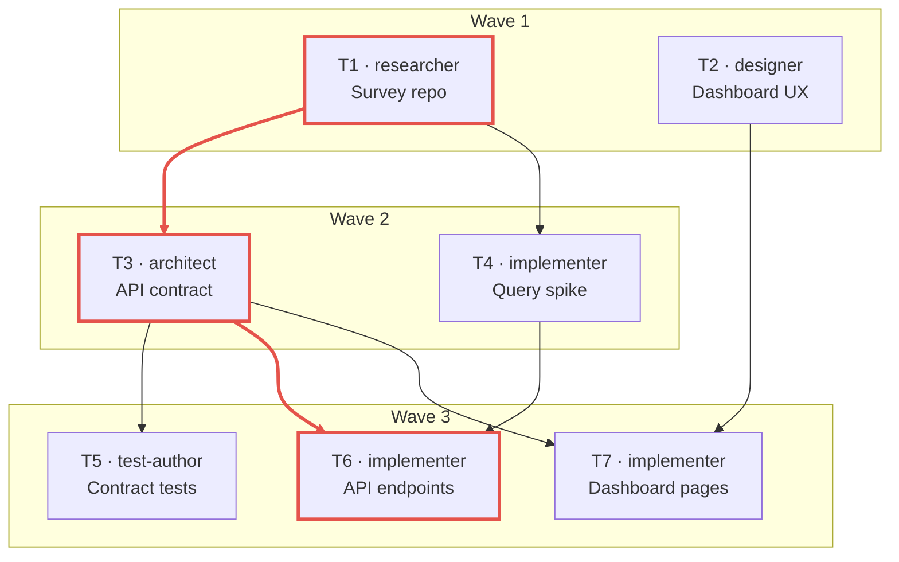

<sub>🔴 Critical path: **T1 → T3 → T6** — the earliest the mission can finish.</sub>

</td>
</tr>
</table>

The plan is validated before you see it: unknown dependencies, cycles, unknown agent roles and two tasks claiming
the same files (`Owns:`) are all rejected, and the conductor has to fix them.

Waves are for display only — the scheduler starts each task **the moment its own dependencies are done**, not
when the whole wave is.

---

## 🎭 Agent roles

Every task runs as a role: a model, a tool list and a set of skills. Read-only roles cannot edit files at all.

| Role | Model | Can edit? | Typical job |
|---|---|:---:|---|
| 🔎 `researcher` | Haiku | ❌ read-only | Survey a codebase, write findings into the handoff note |
| 🏛️ `architect` | Opus | ✅ | System design, API contracts, ADRs |
| 🎨 `designer` | Opus | ✅ | UX, states, wireframes |
| 🧪 `test-author` | Sonnet | ✅ | Write failing tests from the spec |
| 🛠️ `implementer` | Sonnet | ✅ | Build it test-first |
| ✅ `spec-reviewer` | Sonnet | ❌ (can run tests) | Does the work match the task's acceptance criteria? |
| 🧐 `code-reviewer` | Opus | ❌ (can run tests) | Correctness, security, quality |
| 🐞 `debugger` | Opus | ✅ | Systematic debugging of a failure |
| 🚦 `qa` | Sonnet | ✅ | Verify end to end, with evidence |

Roles live in [`agents/`](agents) as Markdown files — add your own.

---

## 🔄 Lifecycles

<table>
<tr>
<td width="50%" valign="top">

**A mission**

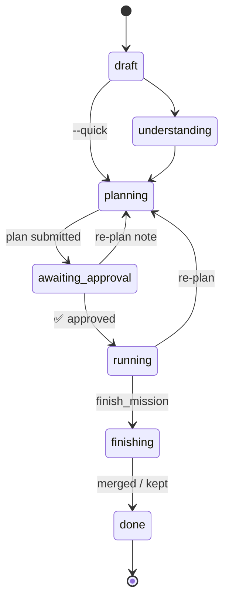

</td>
<td width="50%" valign="top">

**A task**

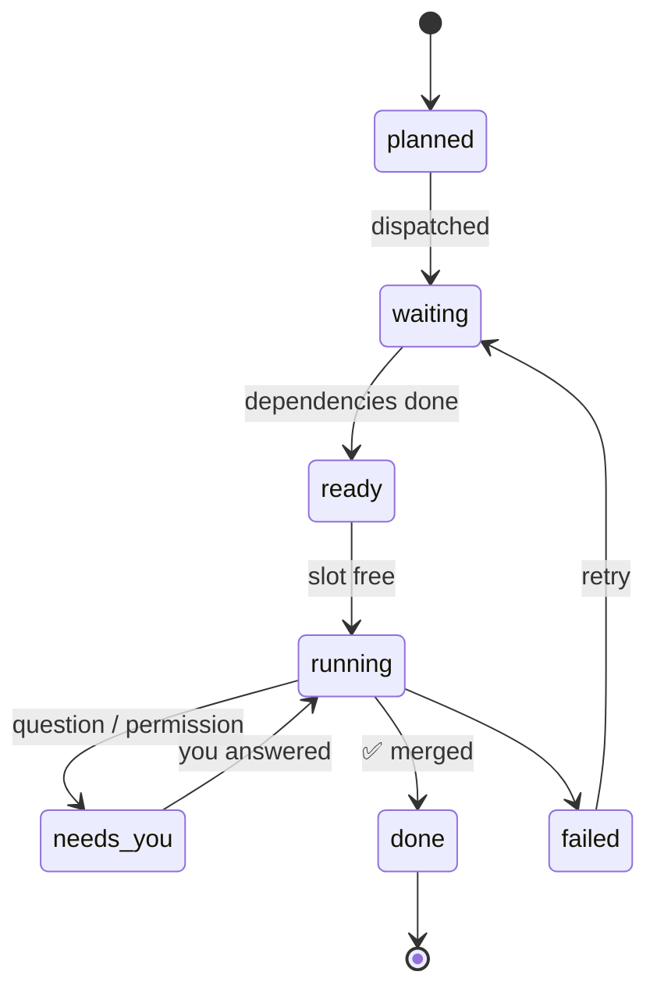

</td>
</tr>
</table>

Any mission or task can also be stopped. If Maestro or the machine dies mid-mission, the next start **recovers**
it: live sessions are resumed, and questions that can no longer be answered are expired instead of hanging.

---

## 📥 One inbox for everything that needs you

Five parallel Claude sessions do not mean five terminals to babysit. Everything that needs a human lands in one
queue, numbered, with who is asking:

| Kind | Example | Your answer |
|---|---|---|
| **Plan approval** | `#1 Plan approval (version 1)` + tasks, waves, critical path | `y`, or a note → re-plan |
| **Permission** | `#2 Permission request from T2 — Bash: npm test` | `y` once · `a` always for this mission · `n` deny |
| **Question** | `#4 Question from conductor: Postgres or SQLite?` | pick an option |
| **Merge decision** | `#10 Mission finished — merge decision` | `m` merge · `k` keep branch |

Routine, harmless commands inside a task's own worktree (`git status`, `git add`, `git commit`, …) are
auto-allowed from a pinned safe list, so the prompts you *do* see are the ones worth reading.

---

## 🛡️ Safe by design

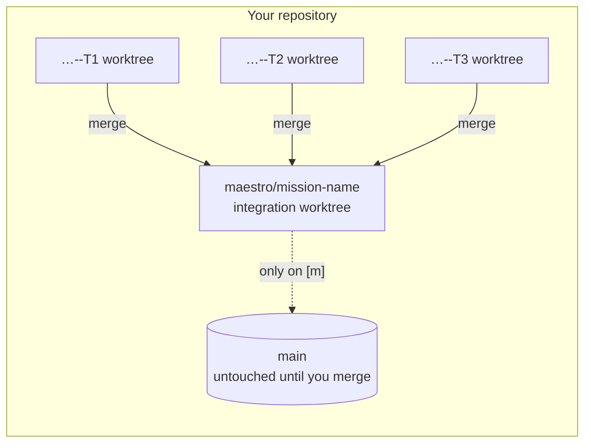

- **Isolation** — every task gets its own branch and worktree; tasks cannot step on each other or on your checkout.
- **Nothing reaches `main` without you** — the final merge is always your explicit choice.
- **Real tool restriction** — read-only roles run with an explicit `--tools` allow-list and `--strict-mcp-config`
  (we verified `--allowedTools` alone does *not* restrict tools).
- **No surprise code execution** — git hooks, `fsmonitor` and diff drivers are disabled inside tasks; running tests
  (which runs code) is an informed, per-mission opt-in, off by default.
- **Your own login** — Maestro starts *your* logged-in `claude` CLI and never touches credentials.
- **Clean stop** — `Ctrl+C` stops the conductor and every task (whole process trees, Windows-safe).

---

## 🏗️ Architecture

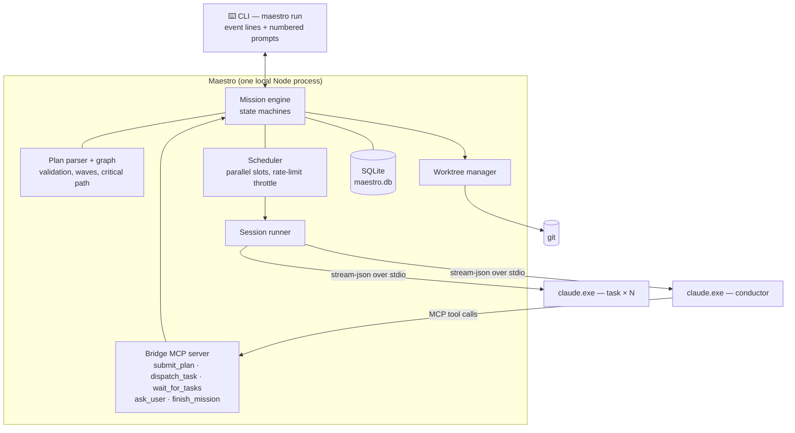

- One long-lived `claude` process per session, driven over **stream-json** on stdin/stdout.
- Permission requests come back through `--permission-prompt-tool stdio` and go to the inbox.
- The conductor never uses Claude's built-in subagents — it calls Maestro's bridge tools, so every piece of work is
  a visible, controllable task.
- 5-hour / 7-day usage windows are read from Claude's rate-limit events and used to throttle new work.

---

## 🚀 Quick start

Requires **Node 22+**, **git**, and the **Claude Code CLI** installed and logged in.

```bash
npm install
```

```bash
npm test
```

```bash
npm run maestro -- run --project C:\path\to\repo --brief brief.md --parallel 3
```

| Option | Meaning |
|---|---|
| `--project <path>` | the git repository to work in (required) |
| `--brief <file>` | Markdown brief; the first `# ` heading becomes the title (required) |
| `--quick` | skip the understanding step, go straight to planning |
| `--parallel <n>` | tasks running at the same time (default 3, max 16) |
| `--base <branch>` | branch to build on and merge into (default `main`) |
| `--db <path>` | database file (default `%APPDATA%\Maestro\maestro.db`) |
| `--no-auto-allow` | ask about every task shell command, including the safe list |
| `--auto-run-tests` / `--no-auto-run-tests` | answer the start-up "may tasks run tests?" question up front |

Exit code `0` when the mission finishes, `1` if it is stopped or fails. A step-by-step first run is in
[`HOW-TO-RUN-E2E.md`](docs/superpowers/runs/HOW-TO-RUN-E2E.md).

---

## 🗺️ Roadmap: the web UI

The engine and CLI work today. Next is a local web UI on top of the same engine. Early wireframes:

<table>
<tr>
<td align="center">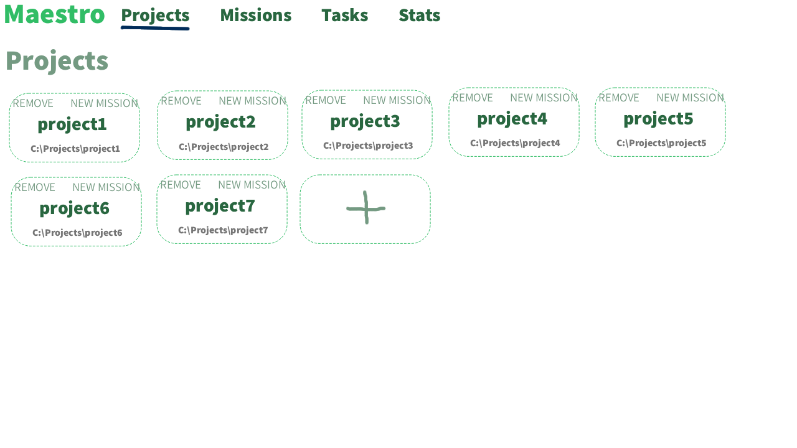<br/><sub><b>Projects</b> — your repos, start a mission</sub></td>
<td align="center">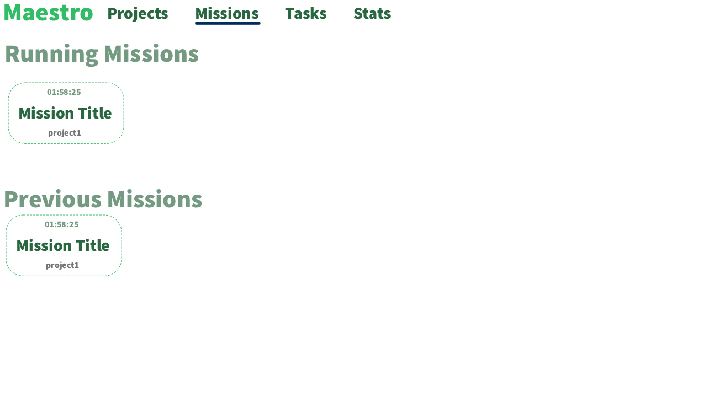<br/><sub><b>Missions</b> — running and finished</sub></td>
<td align="center">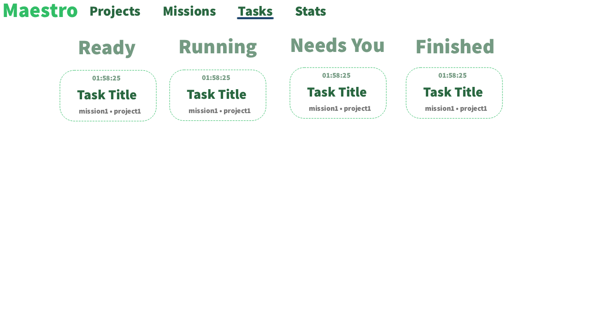<br/><sub><b>Tasks</b> — Ready · Running · Needs You · Finished</sub></td>
</tr>
</table>

---

## 📁 Project layout

```
src/
  core/      plan parser + graph, scheduler, mission & task state machines
  engine/    mission engine, task runner, inbox, recovery, safe-command list, throttle
  claude/    finding claude.exe, stream-json protocol, sessions, process-tree kill
  bridge/    MCP server the conductor talks to (submit_plan, dispatch_task, …)
  git/       worktrees, locked-down git environment
  store/     SQLite schema, migrations, repositories
  cli/       `maestro run`: event formatting and terminal prompts
agents/      role definitions (model, tools, skills, instructions)
prompts/     the conductor's system prompt
test/        632 tests, incl. a fake `claude` that replays recorded stream-json
docs/        design spec, implementation plans, spike reports, real-run logs
```

The full design — every decision and the evidence behind it — is in
[`docs/superpowers/specs/2026-10-28-maestro-design.md`](docs/superpowers/specs/2026-10-28-maestro-design.md).
